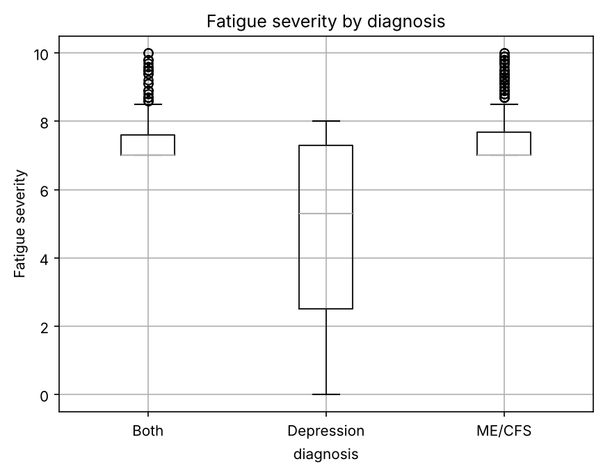
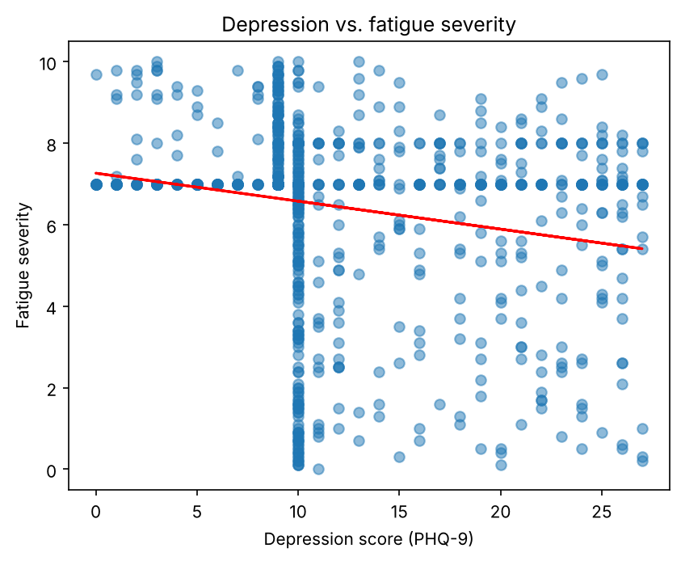

# Clinical Data Analysis: Depression vs. Fatigue Severity

A Python data analysis project testing whether depression severity is linked to fatigue severity across 1,000 patient records with ME/CFS, depression, or both.

## Key findings



- **The hypothesis was not supported.** Across all patients, depression and fatigue show only a weak negative correlation (**Pearson r ≈ −0.20, p < 0.001, n = 957**).
- **Diagnosis drives the pattern.** ME/CFS patients have high fatigue but low depression, depression patients the opposite, and patients with both conditions score high on both.

| Diagnosis | Mean depression (PHQ-9) | Mean fatigue |
|---|---|---|
| ME/CFS | 7.4 | 7.5 |
| Depression | 15.0 | 4.8 |
| Both | 16.4 | 7.5 |

- Together, the two scores clearly separate the three diagnosis groups, which makes them strong candidate features for a classification model.
- **Data quality flag:** dense bands at PHQ-9 ≈ 9–10 and fatigue = 7 in the scatter plot suggest imputed or default values.



## What the project covers

1. **Data quality assessment:** completeness, validity, consistency, and range checks across 16 variables. About 2–5% of values were missing in several fields.
2. **Data cleaning:** handled missing values by filtering on the variables of interest.
3. **Statistical analysis:** Pearson correlation with SciPy.
4. **Group comparisons:** pivot tables and crosstabs by diagnosis and gender.
5. **Visualisation:** scatter plot with a regression line, and a box plot of fatigue by diagnosis.

## Tech stack

Python · pandas · NumPy · SciPy · Matplotlib · Jupyter Notebook

## Run it

```bash
pip install pandas numpy scipy matplotlib jupyter
jupyter notebook analysis.ipynb
```

Place the dataset at `data/DATASET.csv` before running.

## Author

Angelo Dargham, Computer Science student at the Arab Open University (Lebanon).
Built as part of TM351 Data Management and Analysis.
